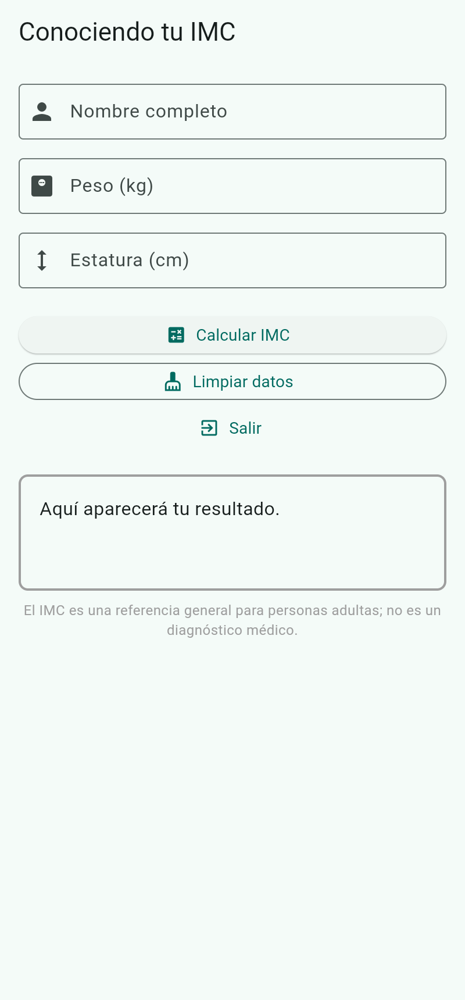
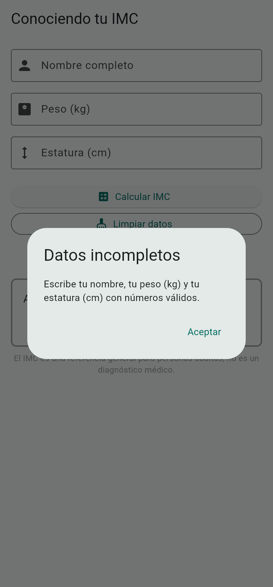
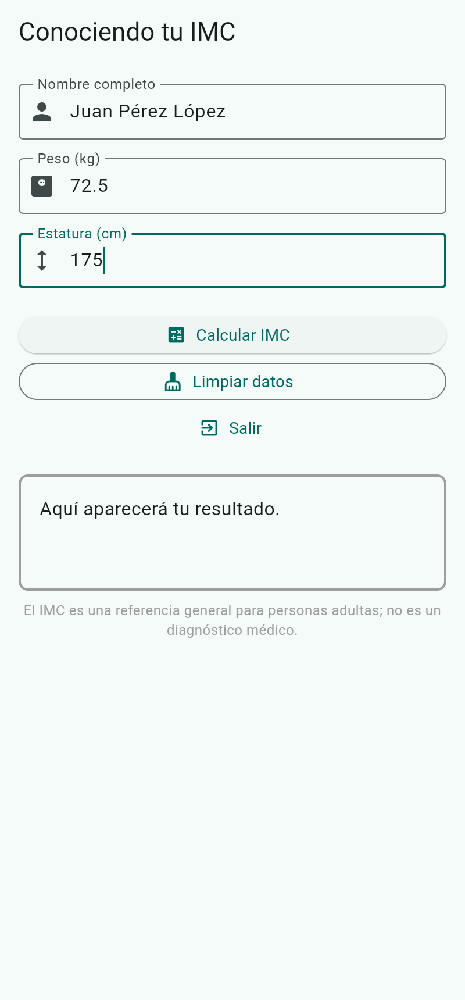
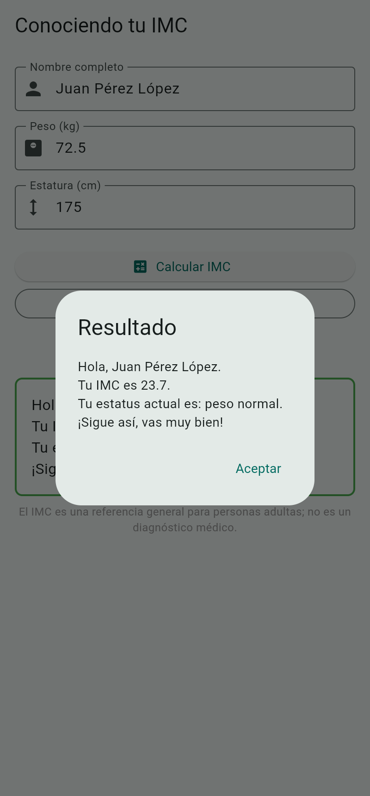
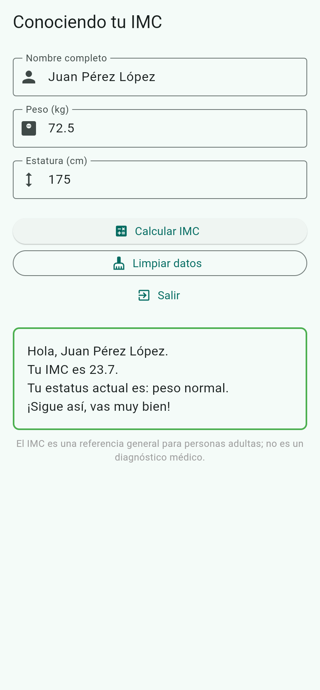
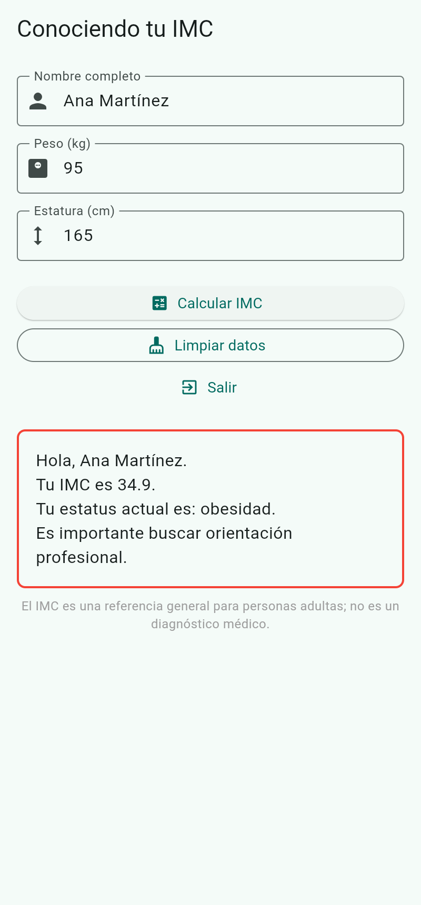

# Conociendo tu IMC

Aplicación móvil hecha en Flutter que calcula el Índice de Masa Corporal (IMC) de una persona adulta, lo clasifica y muestra una recomendación breve.

**Autor:** Oscar Manuel Ayala Ortiz

## 1. Descripción breve

La persona captura su nombre completo, su peso en kilogramos y su estatura en centímetros. Al presionar **Calcular IMC**, la app valida los datos, calcula el índice, lo clasifica y muestra el resultado en dos lugares a la vez: un cuadro de diálogo y una etiqueta en pantalla con el borde del color de su categoría.

La fórmula es `IMC = peso (kg) ÷ estatura (m)²`. La estatura se captura en centímetros y se divide entre 100 para convertirla a metros. El resultado se redondea a un decimal **antes** de clasificarlo, de modo que un 24.96 se evalúa como 25.0 y cae en sobrepeso.

El IMC es una referencia general para adultos y no sustituye un diagnóstico médico. La propia app lo indica al pie de la pantalla.

## 2. Reglas de la aplicación

| Categoría | Rango de IMC | Color del borde |
|-----------|--------------|-----------------|
| Bajo peso | menor a 18.5 | Azul |
| Peso normal | 18.5 a 24.9 | Verde |
| Sobrepeso | 25.0 a 29.9 | Naranja |
| Obesidad | 30.0 o más | Rojo |

**Campos de captura**

| Campo | Teclado | Restricción |
|-------|---------|-------------|
| Nombre completo | Texto | Cada palabra inicia con mayúscula |
| Peso (kg) | Numérico con decimal | Un solo punto y hasta dos decimales |
| Estatura (cm) | Numérico | Solo dígitos enteros |

**Botones**

- **Calcular IMC:** valida, calcula y muestra el resultado. Si falta un dato o es cero, abre el diálogo *Datos incompletos*.
- **Limpiar datos:** vacía los tres campos y restablece la etiqueta de resultado.
- **Salir:** cierra la aplicación (funciona en Android).

## 3. Estructura del código

```
imc/
├── lib/
│   └── main.dart          # Lógica del IMC + interfaz
├── test/
│   └── widget_test.dart   # Pruebas unitarias y de widget
├── capturas/              # Screenshots usados en este README
└── pubspec.yaml
```

La lógica vive en funciones puras fuera del widget, para poder probarla sin levantar la interfaz:

- `calcularImc(pesoKg, estaturaCm)`: calcula y redondea a un decimal.
- `obtenerCategoria(imc)`: aplica los límites 18.5, 25 y 30.
- `obtenerRecomendacion(categoria)`: devuelve el mensaje para cada categoría.
- `obtenerColor(categoria)`: devuelve el color del borde de la etiqueta.

La pantalla `ImcPage` es un `StatefulWidget`: un `TextEditingController` por campo y un `setState` que actualiza la etiqueta de resultado.

## 4. Cómo ejecutar la app

Requisitos: Flutter 3 o superior (Dart 3.13).

```bash
# 1) Dependencias
flutter pub get

# 2) Ejecutar en emulador o dispositivo físico
flutter run
```

## 5. Screenshots

### Pantalla inicial



### Validación de datos incompletos



### Datos capturados



### Diálogo de resultado



### Resultado en pantalla



### Caso de obesidad



## 6. Pruebas (`flutter test`)

```bash
flutter test
```

Las pruebas están en `test/widget_test.dart` y cubren:

| Caso | Peso (kg) | Estatura (cm) | IMC esperado | Categoría |
|------|-----------|---------------|--------------|-----------|
| 1 | 45 | 160 | 17.6 | Bajo peso |
| 2 | 70 | 175 | 22.9 | Peso normal |
| 3 | 75 | 165 | 27.5 | Sobrepeso |
| 4 | 100 | 170 | 34.6 | Obesidad |
| 5 | 60 | 180 | 18.5 | Peso normal (límite inferior) |
| 6 | 73 | 170 | 25.3 | Sobrepeso (límite) |
| 7 | 87 | 170 | 30.1 | Obesidad (límite) |
| 8 | Datos incompletos | | | Muestra el diálogo *Datos incompletos* |
| 9 | Limpiar datos | | | Vacía campos y etiqueta |

Además se comprueba que el redondeo se aplica antes de clasificar (24.96 → 25.0 → sobrepeso) y que el mensaje aparece tanto en el diálogo como en la etiqueta.
